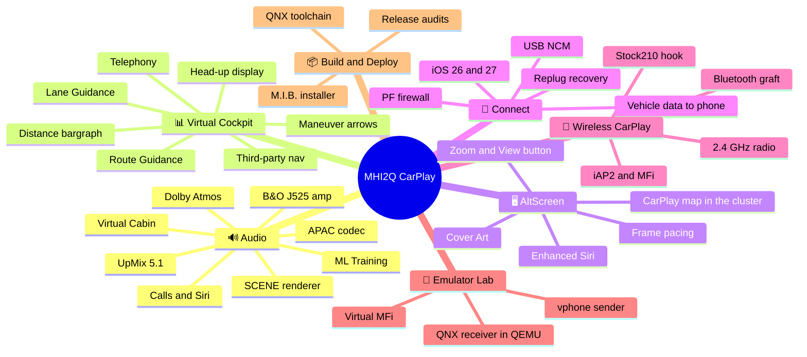

# MHI2Q CarPlay cluster integration

_CarPlay for the Audi MHI2Q head unit: the phone's cluster map on map-over-MOST clusters (this fork), and upstream's map and route guidance in the Virtual Cockpit, calls on the cluster, and 5.1 sound._

> [!WARNING]
> **Please update the head unit to the latest firmware available for your region first, and only
> then install the patch.** Much older firmware may not be compatible: the MMI can stay on the Audi
> logo after the first reboot. Latest versions:
>
> - `MHI2Q_US_AUG22_P5087` (MU1316)
> - `MHI2Q_ER_AUG22_P5092` (MU1329)
> - `MHI2Q_CN_AUG22_K1004` (MU1003)
>
> Already stuck on the logo? Follow the
> [recovery guide](https://github.com/luka-dev/mib2q-carplay-rgi/issues/24#issuecomment-5849641990).

---

> **Fork of [luka-dev/mib2q-carplay-rgi](https://github.com/luka-dev/mib2q-carplay-rgi).**
> Everything described below for the Virtual Cockpit, route guidance, calls, sound, cover art,
> parking, input, the hook framework and the toolchain is Luka's work. This fork adds CarPlay on
> map-over-MOST clusters (analogue clusters with a colour centre display): the phone's own cluster
> map in the MAP view and CarPlay's maneuver in the arrows view, plus a Windows build and packaging
> workflow. Its packages are built for MU1329 and do not yet ship upstream's calls, 5.1 sound,
> vehicle data or wireless features. Thanks to [Luka](https://github.com/luka-dev) for the project
> this is built on.

Production implementation for Audi MHI2Q (MU1316, QNX 6.5 ARMv7):

- stock `libairplay.so` 210.81 inside `dio_manager`;
- `LD_PRELOAD` hook for CarPlay negotiation, route guidance, telephony (recents/favorites,
  signal, hold and mute), altScreen stream 111 and the buffered/upmixed 5.1 audio path;
- external QNX renderers for maneuver graphics and cluster video;
- one Java patch for cluster context, BAP/RGI, the cluster telephone tab (CarPlay calls), cover art
  and steering-wheel input.

The shipped path always keeps stock `libairplay.so`. From-source libairplay/dio experiments are
research records, not production dependencies or authorities for stock 210 behavior.

**Disclaimer:** use at your own risk. These patches modify firmware binaries and system
configuration on your infotainment unit. The installer keeps a `.carplay-stock` backup of every
file it replaces, but back up anything you change by hand as well. The authors are not
responsible for any damage, bricked units or warranty issues resulting from their use.

<a id="contents"></a>

## 📍 Contents

- [Features](#features)
- [Repository layout](#repository-layout) · [Build](#build)
- [Deployment](#deployment): [install with M.I.B.](#install-with-mib) · [manual install](#manual-install) · [reboot and check](#reboot-and-check) · [uninstall](#uninstall)
- [Logging](#logging) · [Documentation](#documentation) · [Help wanted](#help-wanted) · [License](#license) · [References](#references)

<a id="features"></a>

## 🎯 Features

There is nothing to switch on: plug in the iPhone and CarPlay starts as usual; the cluster
features below follow it automatically.

### MOST clusters (this fork)

- **The phone's CarPlay map on the cluster.** On an analogue cluster with a colour centre
  display coded for map-over-MOST (coding 541=1), the stock MAP view shows the iPhone's own
  CarPlay cluster map while any CarPlay navigation runs, including apps that send no route
  guidance, such as Waze. The head unit offers the phone a second, cluster-map CarPlay
  display; its stream is received, decrypted and decoded by the head unit's hardware decoder.
  The map sits between the dials, the steering-wheel roller zooms it, and it follows the
  cluster's Light / Dark / Automatic map setting. Verified on MU1329; the Audi map returns when
  navigation ends ([status and limits](docs/cluster-and-rgi/MOST_MAP_VIEW.md)).
- **Turn-by-turn on MOST clusters.** CarPlay's maneuver appears in the stock arrows view,
  rendered at the view's native size. Stock view selection stays in charge, and Audi guidance
  returns on disconnect ([details](docs/cluster-and-rgi/MOST_CLUSTER.md)).

### Virtual Cockpit and everything else (upstream)

- **CarPlay map in the Virtual Cockpit.** The phone streams its own map to the cluster (Apple's
  second-screen "altScreen" stream). It shows while CarPlay is connected, even without an active
  route. The **Audi View** button switches the cluster between its classic and large layouts as
  with the stock navigation, and the **steering-wheel roller** zooms the cluster map. A short
  animation fills the cluster until the first video frame arrives.
- **Turn-by-turn on the cluster.** During CarPlay navigation the cluster shows a 3D maneuver
  arrow beside the map. Its distance bar fills as the turn approaches and blinks just before it.
  The cluster also shows lane arrows, distance to the turn, arrival time and remaining distance.
  With an app that sends CarPlay route guidance (Apple Maps, recent AMap) the cluster draws all
  of this itself and the phone streams the map alone, so nothing appears twice. Apps that do not
  (Waze) still show guidance on the cluster: the phone then draws its own turn card and arrival
  time into the cluster map, as far as the app provides them
  ([details](docs/cluster-and-rgi/THIRD_PARTY_NAV_APPS.md)).
- **Route text in the Virtual Cockpit.** A text line under the map names the exit sign or the
  next road (the current road when there is nothing else); long names scroll. Press **OK** (the
  left steering-wheel roller) to switch it to arrival time and time left, and press again to go
  back ([details](docs/cluster-and-rgi/RGI_AND_BAP_BRIDGE.md#-route-text-eta-and-the-mfw-ok-key)).
- **Head-up display.** The same maneuver icons, lane arrows and distance appear on the HUD.
- **Cover art on the cluster.** The now-playing album art shows on the cluster media screen.
- **CarPlay calls on the cluster phone tab.** Instead of the stock "Your iPhone is in Apple
  CarPlay mode" note, the Virtual Cockpit telephone tab works as with a Bluetooth phone: caller
  name and number, call state and timer, accept / hang up (tab or steering wheel), hold, mute and
  dialling, recents and favorites, the missed-call indication, signal and carrier. There is no
  caller photo: iPhone does not send one to the car
  ([details](docs/cluster-and-rgi/CARPLAY_TELEPHONY.md)).
- **MMI touchpad moves the CarPlay focus.** Stock only highlighted the focused item; a swipe on
  the touchpad now steps the focus through lists and buttons, faster swipes stepping further.
  It runs as a D-pad bridge in Java, because iOS's native trackpad mode crashes Apple Music on
  iOS 27.2 beta ([details](docs/reference/ARCHITECTURE.md#mmi-touchpad)).
- **Car data to the iPhone.** The phone receives wheel speed (one PASCD sentence per second, for
  apps that use it alongside GPS), the remaining range, the outside temperature and the low-fuel
  warning. The iPhone battery on the cluster phone tab does not show yet: the phone does not
  send its level ([details](docs/connect-and-usb/VEHICLE_DATA_TO_PHONE.md)).
- **Siri on a short press.** A short press of the steering-wheel voice key opens Siri instead
  of the car's own voice control while CarPlay is connected (long press already did)
  ([details](docs/connect-and-usb/VEHICLE_DATA_TO_PHONE.md)).
- **Parking popups no longer hide CarPlay.** When the Audi front PDC / parking view pops up,
  CarPlay stays on screen beside it instead of being replaced.
- **5.1 surround for CarPlay music (B&O).** The head unit feeds the external B&O amplifier six
  channels instead of two, and the amplifier's own Virtual Cabin processing spreads them over the
  cabin speakers ([details](docs/audio/README.md)).
  - *Spatial input:* Spatial Audio / Dolby Atmos tracks from Apple Music arrive as real 5.1 in
    Apple's APAC codec. The head unit decodes them and plays each channel on its own speaker
    group, with no upmix.
  - *Stereo input* (most music, and apps such as Spotify): the head unit's scene renderer
    upmixes it. It reads the stereo image itself: instruments the mix places off-centre move to
    the rear speakers as whole objects, the room ambience goes behind as a wide layer, vocals,
    bass and drums stay anchored in front, and a small network (the mask net) decides per band
    which parts may move; the subwoofer gets its own bass feed. Calls and Siri stay plain stereo
    ([details](docs/audio/STEREO_TO_5_1_UPMIX.md)).
  - *UpMix level in the MMI:* a **CarPlay UpMix** row in the Sound effects menu sets Off,
    Moderate, Normal, Full or Aggressive; the change applies live with a short fade and is kept
    across restarts. The levels above Off differ subtly; they are easiest to hear with the fader
    to the rear
    ([details](docs/reference/HOOK_TO_JAVA_BUS.md)).
  - *Recommended MMI sound settings to start with:* every equalizer band at 0 (dials centred),
    **Surround level** at 0, which is the far-left end of the slider, **3D effect** Off,
    **Focus** All, and **CarPlay UpMix** to taste.
  - Only on an external amplifier. The installer reads the amplifier coding (RCC EEPROM 0xFC):
    on the head unit's own amplifier, which has no six-channel route, CarPlay audio stays stock
    stereo and the CarPlay UpMix row is not shown. Developed on B&O; Bose has not been tried yet.

<a id="repository-layout"></a>

## 🗂️ Repository layout

| Path | Purpose |
| --- | --- |
| `hook/` | Shipping native `libcarplay_hook.so` source |
| `java_patch/` | The only Java patch source |
| `maneuver_render/` | GLES maneuver overlay renderer (cluster plane 98) |
| `altscreen_render/` | OMX/GLES altScreen video renderer and PRISM loader (cluster plane 99) |
| `apac_decoder/` | APAC decoder behind the optional `libcarplay_apac.so` |
| `common/` | Shared QNX Screen surface code |
| `models/` | The scene renderer's mask net (`scene-masknet-c/`) |
| `deploy/` | On-unit runtime scripts, SI child config, patched firmware and PF/deva recipes |
| `scripts/` | Host build and test entry points |
| `install_MoreIncredibleBash/`, `uninstall_MoreIncredibleBash/`, `logging_MoreIncredibleBash/` | M.I.B. SD install / remove / log-collection scripts |
| `tools/` | Host tools (state-trace analyser, VC text data, upmix renderer, QSA emulator, previews) |
| `toolchain/qnx65-abi/` | QNX Screen/OpenMAX ABI headers used only for cross-compilation |
| `docs/` | The documentation (GitHub-rendered; also opens as an Obsidian vault) |
| `build/` | Build outputs (untracked, empty in git) |
| `logs/` | Ignored local evidence: vehicle captures, HU logs, iPhone sysdiagnose, state traces |

Build output, raw unit logs and generated class trees are intentionally kept outside Git.

<a id="build"></a>

## 🔧 Build

Native code needs the QNX 6.5 ARMv7 cross-toolchain image from
[luka-dev/qnx65-armv7-toolchain](https://github.com/luka-dev/qnx65-armv7-toolchain). Build it once:

```sh
git clone https://github.com/luka-dev/qnx65-armv7-toolchain
cd qnx65-armv7-toolchain
./host-scripts/qnx-run.sh build        # qnx65-armv7-toolchain:latest (GCC 8.5)
./host-scripts/qnx-run.sh build 4.9    # optional: :4.9 (GCC 4.9.4)
```

Then run from this repository's root:

```sh
./scripts/build_java.sh
./scripts/build_hook.sh
./scripts/build_renderers.sh
```

The Java patch builds in a pinned `eclipse-temurin:8-jdk-jammy` container, so no host JDK is needed. By
default it compiles `java_patch/` against `java_stock/US_MU1316_lsd.jar` and the OSGi jars in
`toolchain/java/`, and also builds `build/carplay_hook_cn.jar` when `java_stock/CN_MU1003_lsd.jar` is
present. Other inputs are environment variables, so no script needs editing:

| Variable | Meaning |
| --- | --- |
| `STOCK_JAR` | the firmware `lsd.jar` to compile and test against (default `java_stock/US_MU1316_lsd.jar`) |
| `STOCK_CN_JAR` | a CN `lsd.jar`; builds `carplay_hook_cn.jar` too. An explicit `STOCK_JAR` builds only the main jar unless this is set |
| `STOCK_EU_JAR` | a second firmware for the per-variant tests and the linkage audit (default `java_stock/EU_MU1329_lsd.jar`) |
| `CARPLAY_DEPENDENCIES` | directory with `org.osgi.framework-1.10.0.jar` and `org.osgi.util.tracker-1.5.4.jar` (default `toolchain/java/`) |
| `STOCK_BOOT_JAR` | the car's class library (`jcl.jar`); optional. The patch compiles against it, or against the stock jar's own `java/` classes if present, else JDK 8 |
| `ASM_JAR`, `ASM_TREE_JAR` | ASM jars for the linkage audit and the PDC tests (default: the ones in the dependencies directory) |
| `JAVA_OUTPUT` | output directory (default `build/`) |
| `CARPLAY_BUILD_ID` | build ID written into the jar (default `git describe --always --dirty`) |

For example `STOCK_JAR=/fw/lsd.jar JAVA_OUTPUT=/tmp/java bash scripts/java/docker.sh build`. The jar is
reproducible (sorted entries, fixed timestamps) and the build rejects non-1.4 class files and missing or
colliding resources. `CARPLAY_TOOLS_DIR` (or `JXE2JAR`) relocates `../../Tools/jxe2jar`, which only the
stock-source audit needs. `CARPLAY_JAVA_IMAGE` and `QNX_TOOLCHAIN_IMAGE` accept immutable image IDs.
Native builds run in the `qnx65-armv7-toolchain` Docker image; `:latest` (the default) is GCC 8.5,
`QNX_TOOLCHAIN_VARIANT=4.9` selects GCC 4.9.4. Renderer import libraries are generated during the
build; the resulting ELFs resolve the real Screen/EGL/GLES/OpenMAX libraries on the unit.

| Variant | Command | Output |
| --- | --- | --- |
| Production | `./scripts/build_hook.sh` | the one image: WARN/ERROR log only; `touch /mnt/app/carplay_verbose` turns on INFO, audio captures and pace reports for the next session |
| No audio module | `HOOK_AUDIO=0 ./scripts/build_hook.sh` | hook without the type-103 audio path, no codec |
| State trace | `AUDIO_STATE_TRACE=1 ./scripts/build_hook.sh` | compact `/tmp/carplay_state_trace.log` ledger (see `scripts/carplay_state_trace.sh`) |

Build outputs (binaries only; `scripts/prepare_install.sh` assembles the install zip from them):

```text
build/carplay_hook.jar
build/unprotected/libcarplay_hook.so
build/unprotected/libcarplay_apac.so
build/maneuver_render
build/altscreen_render
```

Models are versioned in `models/`: `scene-masknet-c/scene_masknet_c.bin`, the scene
renderer's fine mask net c, with its manifest and the knob settings it was measured at.

Tests: `./scripts/run_tests.sh`.

The Java suites use the same Docker image and inputs: `bash scripts/java/docker.sh test [group]` with
`route`, `transports`, `pdc`, `partial360`, `fuzz`, `maneuvers`, `contract` or `linkage` (default `all`,
which leaves out `fuzz` and `maneuvers`). `test_route_info.sh`, `test_java_transports.sh`, `test_pdc.sh`,
`test_partial360_preflight.sh`, `test_route_context_fuzz.sh` and `audit_*.sh` are wrappers over them.
`JAVA_TEST_JOBS` sets how many JVMs run at once (default 2); `./scripts/check_java.sh` runs `all`
with the native RGI contract (the C half needs Python 3 and a host C compiler);
`./scripts/test_java_build.sh` checks reproducibility, build failure cases and the default input layout.

Checked SD-card packages for this fork are prepared by the separate
[mib2q-rgi-tooling](https://github.com/waterfalldev/mib2q-rgi-tooling) repository on Windows. It
runs the commands above in Docker against a pinned firmware's stock JAR, records the source and
tooling commits, and keeps firmware and packages outside Git. Host tests there run in the image
built from `tests/Dockerfile.host`. Component builds and tests do not need it or PowerShell.

AltScreen pacing offline checks (ASan/UBSan, fault injection, Clang analysis and libFuzzer):
`bash scripts/test_altscreen_pacing.sh`; the report lands in `build/altscreen-pacing-validation/`
and `FUZZ_SECONDS` sets the budget per target. Contracts and limits:
[frame rate](docs/altscreen-and-video/ALTSCREEN_FRAME_RATE.md),
[input commands](docs/altscreen-and-video/ALTSCREEN_INPUT_COMMANDS.md) and
[validation](docs/altscreen-and-video/ALTSCREEN_PACING_VALIDATION.md).

<a id="deployment"></a>

## 🚀 Deployment

**Compatibility.** Audi MHI2Q only: the installer reads the firmware version from E2P and stops on
anything else. On a firmware other than the verified ones (US P5087, ER P5092, CN K1004, JP P1017)
it stops once with a warning and changes nothing; running it again before the next reboot installs
anyway. The Java part replaces whole stock HMI classes, so it ships per firmware family and
is chosen by the region in that version string: US, ER and JP (verified on MU1316 P5087, MU1329
P5092, MU1017 P1017) get `carplay_hook.jar`, CN (verified on MU1003 K1004) gets
`carplay_hook_cn.jar`. Any other region installs CarPlay without the Java part (no cluster/HUD
features) until it is added. Also needed:

- cluster coding: Virtual Cockpit (sysConst 541=2) retains its existing presentation;
  map-over-MOST analogue clusters (541=1) can show CarPlay maneuvers in the stock arrows view
  with guidance text; RGI-only clusters (541=0) retain stock context ownership;
- preferably, the latest firmware available for the unit, flashed before installing the patch;
- for 5.1 sound, an external amplifier (B&O, verified; Bose untested). With the head unit's own
  amplifier everything else installs and CarPlay audio stays stock stereo.

With these in place it should almost certainly work, as long as nothing went wrong during the
install itself.

MOST behavior has been exercised on one MU1329 unit and still needs vehicle validation,
including regression checks on a Virtual Cockpit car. See
[MOST cluster](docs/cluster-and-rgi/MOST_CLUSTER.md).

**What gets installed.** Everything the installer replaces or edits keeps a `.carplay-stock`
backup; files it adds have none and are simply removed on uninstall.

| On the unit | What |
| --- | --- |
| `/mnt/app/root/hooks/` | the hook (`libcarplay_hook.so`, `libcarplay_apac.so`), both renderers (`maneuver_render`, `altscreen_render`), `flag_atlas.rgba`, the upmix mask net `scene_masknet_c.bin` and the `carplay_*.sh` runtime scripts |
| `/mnt/app/eso/hmi/lsd/jars/` | the Java patch for this firmware family (one jar, see above) |
| `/mnt/app/eso/bin/apps/smartphone_integrator` | the unit's own file, patched in place by `binpatch.py` (one instruction, the USB error re-arm); a firmware without that code keeps it stock |
| `/mnt/app/armle/lib/dll/deva-ctrl-qc.so` | the six-channel audio driver, always replaced by the patched P5087 driver (P5092 ships the same file, CN K1004 the same code) |
| `/mnt/system/etc/eso/production/smartphone_integrator.json` | the `carplay` child replaced by [`carplay_child.json`](deploy/smartphone_integrator/carplay_child.json) |
| `/mnt/system/etc/eso/production/dio_manager.json` | iAP2 route-guidance, telephony and vehicle-data message IDs (without them iOS sends route guidance and the SDK silently drops it), and the PASCD bit |
| `/mnt/system/etc/pf*.conf` | the CarPlay rule widened in all four PF profiles |
| `/mnt/system/etc/scripts/{start,stop}ncm.sh`, `/mnt/system/etc/usblauncher_otg.lua` | the NCM fence for USB replug recovery |
| `/mnt/app/eso/hmi/lsd/jars/lang_data.zip` | the texts of the CarPlay UpMix row |

<a id="install-with-mib"></a>

**With M.I.B. (recommended).**

1. Get an install zip (`install_*.zip`) or build one with `scripts/prepare_install.sh` (see
   [Build](#build)), and copy the **contents** of its `install_MoreIncredibleBash/` onto the M.I.B.
   SD card, so the card holds `mod/custom.sh` and `mod/carplay/`.
2. Disconnect CarPlay, then run **GEM → M.I.B. → Advanced Settings → Run Custom Script**.
3. `custom.sh` checks the firmware and that the whole payload is on the card (a partial copy stops
   before anything is written), reads the amplifier coding, copies with atomic renames and patches
   the configs in place. It never stops processes or reboots the unit. It also deletes M.I.B.'s
   NavActiveIgnore jar, which breaks CarPlay's app state.

<a id="manual-install"></a>

**Manually** (no M.I.B.; needs a root shell on the unit over SSH or Telnet): `mount -uw /mnt/app`
and `/mnt/system`, copy the files and edit the configs as text (`dio_manager.json` has `##`
comment lines, so no JSON tools). What to copy where and every config change are in
[Manual install](<docs/build-and-deploy/DEPLOY_AND_RELEASE.md#-manual-install-without-mib>); the
source-to-unit map, file modes and hashes are in
[Deploy and Release](<docs/build-and-deploy/DEPLOY_AND_RELEASE.md>).

<a id="reboot-and-check"></a>

**Reboot and check.** The installer runs `sync` itself; still wait a few seconds after it prints
`DONE`, then reboot the head unit with CarPlay disconnected. The jar is on j9's boot classpath, so it only loads after a
full restart. On boot `smartphone_integrator` starts everything; connect the phone and look at
`/tmp/carplay_hook.log` and `/tmp/carplay_java.log` (see [Logging](#logging)).

<a id="uninstall"></a>

**Uninstall.** Copy `uninstall_MoreIncredibleBash/` onto the card and run it the same way: it
restores every `.carplay-stock` backup and deletes the files the installer added. Running it again
changes nothing.

The runtime integration (renderer supervision, environment, spatial/upmix settings) lives in
[`deploy/smartphone_integrator/`](deploy/smartphone_integrator/README.md); the shipped audio
calibration is set in `deploy/smartphone_integrator/carplay_startup.sh` and documented in
[Stereo to 5.1 Upmix](<docs/audio/STEREO_TO_5_1_UPMIX.md>).

<a id="logging"></a>

## 📝 Logging

Everything logs to `/tmp` on the unit, which is RAM: pull the logs before a reboot.

| File | Source |
| --- | --- |
| `/tmp/carplay_hook.log` | native hook (inside `dio_manager`) |
| `/tmp/carplay_java.log` | Java patch (bounded at 512 KB and rotated, `.1` = previous) |
| `/tmp/maneuver_render.log` | cluster maneuver renderer |
| `/tmp/altscreen_render.log` | cluster CarPlay video renderer (rotated, `.1` = previous) |
| `/tmp/carplay_wrapper.log` | startup wrapper and renderer monitor |

By default only warnings and errors are recorded. To capture **everything** (hook and Java at
`INFO`, plus the audio and pacing diagnostics), drop a marker file on the unit; no rebuild needed:

```sh
touch /mnt/app/carplay_verbose        # survives a reboot; /tmp/carplay_verbose does not
```

It takes effect at the next phone connection. Remove the marker to return to the quiet default.
Builds with extra traces (raw route-guidance packets, the audio state ledger) are listed under
[Build](#build).

**No shell? Use M.I.B.** Copy `logging_MoreIncredibleBash/` onto the card and run it like the
installer. Each run saves the logs, process list, mounts, network, PF rules and the MMX and RCC
`sloginfo` to `<card>/carplay_logs/NNN/`, then creates `/tmp/carplay_verbose`. Run it once,
reconnect the phone and drive with CarPlay, run it again: the second folder holds the verbose
session. Attach that folder to a bug report. Nothing on the unit is deleted.

<a id="documentation"></a>

## 📚 Documentation

All documentation is one linked Markdown tree in [`docs/`](docs/README.md). Start at
[`docs/README.md`](docs/README.md), then the per-domain maps.

> 🗺️ **Looking for a note?** The [documentation home](docs/README.md) has every note in one mindmap and, below it, [the same notes as links by topic](docs/README.md#notes-by-topic).

_What the project covers, at a glance._



| Domain | Entry point |
| --- | --- |
| Audio (upmix, scene renderer, J525 amp, codecs, 5.1 routing) | [`docs/audio/README.md`](<docs/audio/README.md>) |
| Cluster and route guidance (contexts, BAP/RGI, HUD renderer, CarPlay telephony) | [`docs/cluster-and-rgi/README.md`](<docs/cluster-and-rgi/README.md>) |
| AltScreen and video (stream 111, OMX pipeline, loader) | [`docs/altscreen-and-video/README.md`](<docs/altscreen-and-video/README.md>) |
| Connect and USB (NCM, replug recovery, PF, session lifecycle) | [`docs/connect-and-usb/README.md`](<docs/connect-and-usb/README.md>) |
| Wireless CarPlay (stock210 hook, btstack graft, iAP2/MFi; parked) | [`docs/wireless-carplay/README.md`](<docs/wireless-carplay/README.md>) |
| Build and deploy (toolchain, release map) | [`docs/build-and-deploy/README.md`](<docs/build-and-deploy/README.md>) |
| Architecture overview | [`docs/reference/ARCHITECTURE.md`](docs/reference/ARCHITECTURE.md) |

Read [`docs/LANDMINES.md`](docs/LANDMINES.md) before touching a subsystem. Long-form white papers
are in `docs/research/`.

<a id="help-wanted"></a>

## 🤝 Help wanted

PRs are welcome: bug fixes, new maneuver cases, docs and on-car test reports, especially from
cars this was not developed on (internal amplifier, Bose, other regions and trains).

**Reporting a bad maneuver icon.** The iAP2 → BAP mapping covers all CarPlay maneuver types but has
been exercised on a limited set of real routes. A snippet of `/tmp/carplay_hook.log` from the moment
and a note on what was expected help a lot. The hook logs a route-guidance message it does not handle
as `Unknown 0x52xx msgid=0xNNNN dir=IN len=N`; that line is the best starting point.

<a id="license"></a>

## 📄 License

GNU General Public License v3.0 or later ([LICENSE](LICENSE)): use, change and share it, also
commercially, as long as the source of what you distribute stays open under the same license and
the copyright notices stay in place. Stock firmware files, jars, fonts and other third-party
material in the repository keep their owners' terms; [NOTICE](NOTICE.md) lists them.

<a id="references"></a>

## 📚 References

Thanks for the prior work and knowledge that helped figure this out:

- https://github.com/ludwig-v/wireless-carplay-dongle-reverse-engineering
- https://github.com/EthanArbuckle/iPhone18-3_26.1_23B85_Restore
- https://github.com/adi961/mib2-android-auto-vc
- [@fifthBro](https://t.me/fifthBro)
- https://github.com/xPaiiN for telephony magic
